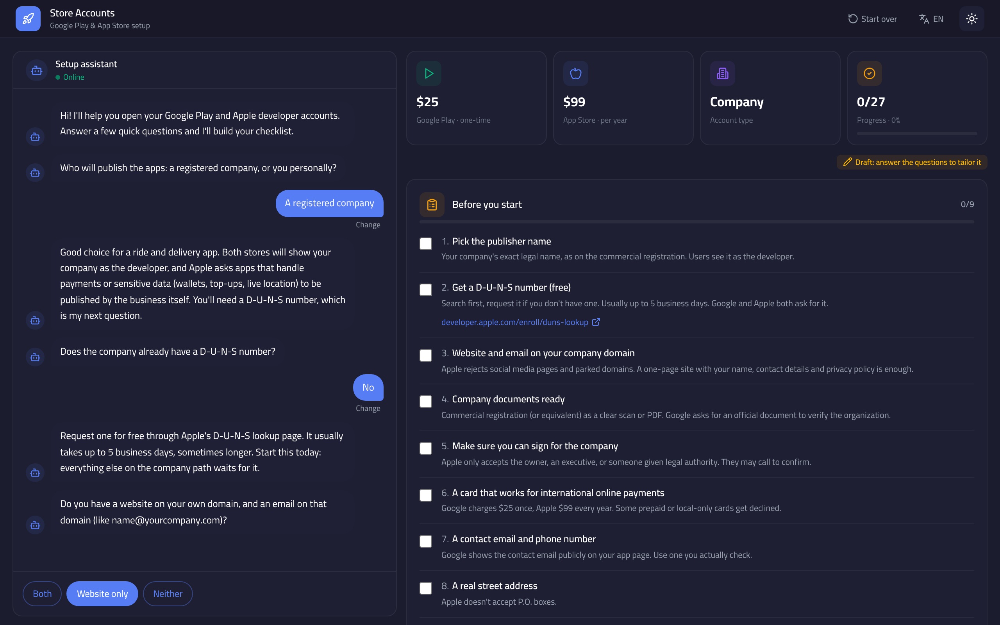

# Store Accounts Setup

An interactive guide for opening a **Google Play Console** account and an **Apple Developer Program** account for a ride and delivery app. It uses the same look as `admin-template`: dark and light themes, the Cairo font, the brand blue, and English or Arabic with full RTL.

There is no build step: open `index.html` in a browser.

## How it works

- **Setup assistant (chat):** asks a few questions: company or personal, D-U-N-S number, website and domain email, Android phone, Mac, in-app payments. It replies to each answer with what it means for you. Tap **Change** under any answer to redo it from there.
- **Plan:** the checklist on the side updates as you answer. It has three parts: *Before you start*, *Google Play Console* and *Apple Developer Program*. A *Heads up* section covers ride and delivery issues: account deletion, background location, payments and EU trader status.
- **Progress:** answers and ticked steps are saved in this browser (`localStorage`). **Start over** clears them.

## Files

| File | Purpose |
| --- | --- |
| `index.html` | Layout shell and theme tokens (copied from `admin-template`) |
| `app.js` | Questions, replies, plan steps (all EN/AR), rendering, theme and language toggles |

## Editing the content

- **Questions and replies:** the `Q` array in `app.js`. `when(answers)` decides whether a question is asked.
- **Plan steps:** the `PLAN` array. `s` is the section; `when(c)` shows a step only for some answers (`c.company`, `c.a.<questionId>`). `t` and `d` can be `{ en, ar }` or a function returning one.
- **Fees and links:** the `LINKS` object and the `p-card`, `g-fee` and `a-fee` steps.

Store rules and fees change. The content was last reviewed in November 2026. Check the official pages before relying on it:
[Play Console Help](https://support.google.com/googleplay/android-developer) ·
[Apple Developer Program enrollment](https://developer.apple.com/programs/enroll/)
